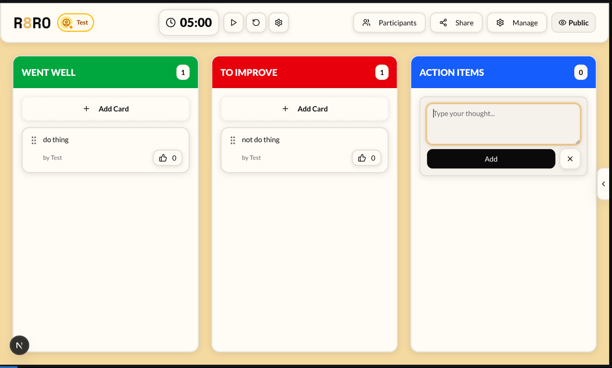

# r8ro

[](LICENSE)
[](https://github.com/grikomsn/r8ro/actions/workflows/ci.yml)
[](https://github.com/grikomsn/r8ro/actions/workflows/secret-scan.yml)

Realtime retrospective boards and planning poker built with Next.js and
Supabase. The deployed app is [r8ro.app](https://r8ro.app).



## Current Features

### Retrospectives

- Three columns: Went Well, To Improve, and Action Items.
- Realtime cards, votes, participants, and presence.
- Shared timer and recent-board history.
- Author controls for title, visibility, lock state, and deletion.
- Unlocked boards let participants add, edit, move, delete, and vote on cards.
- Locked boards are frozen for everyone, including the author.

### Planning Poker

- Fibonacci, T-shirt, and linear voting scales.
- Realtime participants, votes, and presence.
- Author controls for title, story, visibility, voting state, vote reveal, vote
  clearing, and scale.
- Vote statistics after reveal: minimum, maximum, average, mode and outliers
  for a numeric scale, and a distribution for a non-numeric one.
- Votes stay hidden until the session is revealed, enforced by the database.

Every visitor signs in through Supabase anonymous authentication. An anonymous
account can optionally be linked to GitHub. A private board or session stays
visible to the people already on it, and everybody else is treated as if it did
not exist.

Every user can download a JSON archive of the boards and sessions they created
or joined, from the account menu.

## Stack

- Next.js 16 and React 19
- TypeScript
- Tailwind CSS 4 and shadcn/ui
- Supabase Auth, PostgreSQL, Row Level Security, and Realtime
- Vercel

## Local Setup

Requirements:

- Node.js 24
- pnpm 11
- Docker, for the local Supabase stack
- The Supabase CLI, for the local stack

With the local Supabase stack:

```bash
pnpm install --frozen-lockfile
supabase start
pnpm dev
```

`supabase start` applies every file in `supabase/migrations/` and prints the
local API URL and keys. Point `NEXT_PUBLIC_SUPABASE_URL` at
`http://127.0.0.1:54321` and copy the printed keys into `.env.local`.

With a hosted Supabase project:

```bash
pnpm install --frozen-lockfile
cp .env.example .env.local
pnpm dev
```

Set these values in `.env.local`:

| Variable | Required | Notes |
| --- | --- | --- |
| `NEXT_PUBLIC_SUPABASE_URL` | Yes | Supabase project URL |
| `NEXT_PUBLIC_SUPABASE_ANON_KEY` | Yes | Browser-safe anon/publishable key |
| `SUPABASE_SERVICE_ROLE_KEY` | For GitHub merge fallback | Server only |
| `AUTH_LINK_COOKIE_SECRET` | No | Server-only HMAC secret; falls back to the service-role key |

Never expose a service-role key through a `NEXT_PUBLIC_` variable.

For a new database, apply every file in `supabase/migrations/` in filename
order. The retro baseline is the first migration in that directory. Enable
anonymous authentication and configure the callback URLs described in
[docs/deployment.md](docs/deployment.md).

## Validation

```bash
pnpm fix
pnpm check-types
pnpm build
```

`pnpm check-types` is required because the Next.js build is configured to skip
TypeScript errors.

## Documentation

- [Architecture overview](docs/overview.md)
- [Retro behavior](docs/features/retro.md)
- [Poker behavior](docs/features/poker.md)
- [Supabase data model and RLS](docs/data-model/supabase.md)
- [Operations](docs/operations.md)
- [Deployment](docs/deployment.md)

See [CONTRIBUTING.md](CONTRIBUTING.md) before opening a pull request and
[SECURITY.md](SECURITY.md) for private vulnerability reporting.

## License

[MIT](LICENSE)
